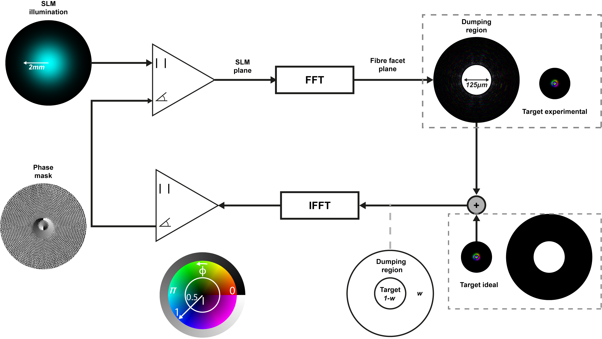

# Gerchberg–Saxton (GS) for phase and amplitude light control



GPU Gerchberg–Saxton phase-mask generation for multimode fibre injection / SLM control. Built on the ModeLab packaging stack: install a tagged release and pip pulls pinned siblings (notably `fibremodes`).

## Package layout

```
gs/
├── pyGS.py              unified GS engine
├── toolbox/             optical_setup, GS_mask_setup, planes, filters, modes, memory
├── legacy/              pyPhasemasks and modemasks (regression tests only)
├── test/                notebooks and regression helpers
├── scripts/release.py   git-tag release automation
├── pyproject.toml       package metadata + version
└── CHANGELOG.md
```

## ModeLab dependency stack

```
fibremodes@v1.1.1  (+ cupy-cuda13x via [gpu])
        ↑
      gs@v1.1.0
```

`gs` pins `fibremodes[gpu]` by git tag in `pyproject.toml`. Installing `gs` pulls fibremodes (LG/HG modes) and CuPy — no manual `sys.path` chaining.

## Using the engine

Build an `optical_setup` (the bench and the fibre), a `GS_mask_setup` (how the Gerchberg–Saxton loop runs), then a `GS` engine in one of two modes.

```python
import numpy as np
from gs import GS, optical_setup, GS_mask_setup

optical = optical_setup(
    wavelength=0.6328,       # um
    fin=4.51,                # mm, SMF collimator onto the SLM
    fout=18,                 # mm, SLM to the MMF face
    masksize=512,            # SLM pixels on a side
    slm_pixel_size=8,        # um
    MMF_mfd=34,              # um, mode-field diameter
    MMF_diameter=50,         # um, core diameter
    MMF_mode_groups=10,
    mode_basis="LG",
)

masksetup = GS_mask_setup(
    convergence_metric="overlap",
    goal_value=0.99,
    min_coupling_SNR_dB=20,
    minium_efficiency=0.1,
    MAX_iterations=300,
    downscale=2,
)

# Desired fields (one mask per coefficient row)
engine = GS(optical, masksetup, engine_mode="fields", number_masks=2)
engine.run(inpucoefs=coefs, verbose=True)

# Or a mask library, one phase mask per fibre mode
library = GS(optical, masksetup, engine_mode="fibremodes", mode_range=(0, 20))
library.run(verbose=True)
```

After `run`, read `phase_masks` with shape `(n_masks, masksize, masksize)` in radians, plus `efficiency`, `iteration_convergence`, `convergence_history`, `efficiency_history`, `D_core_coefs`, and `mask_passed`.

`mask_passed` is `0` when both the overlap goal and the coupling SNR were met, `1` when overlap was short, `2` when the SNR was short, and `3` when both were short.

`legacy/pyPhasemasks.py` and `legacy/modemasks.py` stay in the tree so regression tests can still call the old generators. New work uses `pyGS`.

### Optical setup

`optical_setup` fixes the grid the masks are computed on and the mode basis they are decomposed into. Lengths on the SLM and the fibre face are micrometres. Focal lengths are millimetres. Wavelength is micrometres.

| Argument | Unit | Role |
|---|---|---|
| `wavelength` | µm | Design wavelength. Sets the Fourier pixel size at the fibre face and the SMF waist. |
| `fin` | mm | Focal length of the lens that collimates the input SMF onto the SLM. |
| `fout` | mm | Focal length of the lens that focuses the SLM onto the MMF face. |
| `masksize` | pixels | Side length of the square phase mask written to the SLM. |
| `slm_pixel_size` | µm | Physical pixel pitch of the SLM. |
| `MMF_mfd` | µm | Mode-field diameter used to scale the LG or HG basis. |
| `MMF_diameter` | µm | Core diameter. The core mask is this disk. The region where the target is enforced extends to `filtering_mask_radius_factor` times the core radius. |
| `MMF_mode_groups` | — | How many mode groups to generate. The basis size is `N(N+1)/2` for group count `N`. |
| `mode_basis` | — | `'LG'` (default), `'HG'`, or `'custom'`. |
| `smf_in_NA` | — | Numerical aperture of the input SMF. Default `0.1`. Used only to estimate the illumination waist. |
| `smf_in_diameter` | µm | Input SMF core diameter. Default `9`. |
| `W0_slm` | µm | Beam waist on the SLM. Leave as `None` to compute it from the SMF, `fin`, and wavelength. Set it to skip that estimate. |

Illumination is a normalized Gaussian on the SLM. With `W0_slm=None` the waist is the SMF mode propagated through `fin`. A custom basis skips automatic mode generation: pass the stack to `engine.set_mode_basis(modes)` as `(n_modes, N, N)` before `run`.

### Mask setup

`GS_mask_setup` is scalar. It does not hold fields or coefficients. It sets the sampling of the SLM grid, the stop rule, and how light outside the core is treated.

| Argument | Default | Role |
|---|---|---|
| `convergence_metric` | `'overlap'` | `'overlap'` or `'crosstalk'`. The loop scores `'overlap'`: squared overlap between the target modal coefficients and the coefficients of the field at the fibre face, after the power in the basis is normalized. `'crosstalk'` is accepted by the constructor and is not scored in the loop yet. |
| `goal_value` | `0.99` | Overlap the mask must reach. |
| `min_coupling_SNR_dB` | `20` | Minimum ratio, in dB, of power coupled into the basis over power left in the core but outside the basis. |
| `minium_efficiency` | `0.1` | Stop that mask if the fraction of power inside the core disk falls to this floor or below. |
| `convergence_check_interval` | `1` | How many iterations between stop checks. |
| `MAX_iterations` | `300` | Hard cap per mask. |
| `downscale` | `1` | Integer binning of the SLM. Effective pixel pitch grows by this factor and the physical SLM size stays the same, which cuts the highest spatial frequencies. |
| `upsample` | `0` | Pad the computed grid by this many extra SLM widths so the fibre-face pixels get finer. |
| `filtering` | `False` | Multiply light outside the forbidden disk by a Gaussian before it is scattered. |
| `filtering_factor` | `2` | Width of that Gaussian. Larger values suppress high frequencies more strongly. |
| `filtering_mask_radius_factor` | `4` | Forbidden-disk radius in units of the core radius. Light inside this disk is the field the loop tries to match. Light outside it is the scatter used to shape amplitude. |

A mask stops when the overlap is at least `goal_value` and the coupling SNR is at least `min_coupling_SNR_dB`, or when the core power drops to `minium_efficiency`, or when the overlap starts falling, or when `MAX_iterations` is hit. If the overlap falls, the previous iteration is kept.

`downscale` still has to leave enough Fourier width to place the forbidden disk on the grid. If that disk is larger than the highest spatial frequency the sampled SLM can reach, setup raises `ValueError`.

`num_masks` on `GS_mask_setup` is stored and is not what sizes the run. For desired fields, pass `number_masks` to `GS`. For the mode library, the count comes from the basis or from `mode_range`.

### Two engine modes

`engine_mode` chooses what the target at the fibre face is.

**`fields` — masks for desired fields.** Each row of `inpucoefs` is one complex coefficient vector in the selected basis, shape `(n_fields, n_modes)`. `run` builds the target field as that row times the mode stack, then iterates until the fibre-face field matches it. `number_masks` is how many masks to allocate (default `2`). Extra coefficient rows beyond that allocation are dropped. This is the path for an image, a spot pattern, or any modal decomposition you want launched into the fibre.

```python
engine = GS(optical, masksetup, engine_mode="fields", number_masks=coefs.shape[0])
engine.run(inpucoefs=coefs, verbose=True)
```

**`fibremodes` — a mask library, one mask per mode.** No coefficients. Each mode in the basis is itself the target, so the result is a catalog of phase masks that launch individual fibre modes. Omit `mode_range` for the full catalog. `mode_range=(first, last)` keeps library indices `first` through `last` inclusive.

LG modes are generated as a half pyramid. A mode with azimuthal index `m = 0` produces one mask. A mode with `m ≠ 0` produces that mask and its partner: the same pattern spatially flipped and conjugated. HG modes and a custom basis have no partner step, so one computed pattern is one stored mask.

```python
library = GS(optical, masksetup, engine_mode="fibremodes", mode_range=(0, 20))
library.run(verbose=True)
```

Overlap is the usual score for desired fields. A mode library is often judged by crosstalk; that metric name is reserved on `GS_mask_setup` and the loop still scores overlap.

## Canonical imports

```python
import gs
from gs import GS, optical_setup, GS_mask_setup
from gs.pyGS import GS
from gs.toolbox.setup import optical_setup, GS_mask_setup
```

## Installation

### From GitHub (tagged release)

```bash
pip install "gs @ git+https://github.com/MarKo7s/GS.git@v1.1.0"
```

That resolves the pinned `fibremodes[gpu] @ …@v1.1.1` (and CuPy via that extra).

Other packages can depend on the same pin in `pyproject.toml`:

```toml
dependencies = [
  "gs @ git+https://github.com/MarKo7s/GS.git@v1.1.0",
]
```

### Local development (editable install)

```bash
git clone git@github.com:MarKo7s/GS.git
cd GS
pip install -e ".[notebooks,test]"
```

### Conda environment

```bash
conda create -n gs python=3.11 -y
conda activate gs
pip install -e ".[notebooks,test]"
```

`fibremodes[gpu]` pulls `cupy-cuda13x` for CUDA toolkit 13.x (e.g. 13.2). Do not install plain `cupy` beside that wheel. Restart Jupyter after setting `CUDA_PATH` if needed.

Register a Jupyter kernel (once):

```bash
python -m ipykernel install --user --name gs --display-name "Python (gs)"
```

`requirements.txt` remains for legacy workflows; prefer `pip install -e ".[notebooks,test]"`.

## Developer notes

### Versioning

The package version is defined in **one place only**: `pyproject.toml` → `[project].version`.

Do **not** edit `__init__.py` on each release. `gs.__version__` is read from pip metadata after install (`importlib.metadata`).

```bash
pip show gs
python -c "import gs, fibremodes; print(gs.__version__, fibremodes.__version__)"
```

Use [semantic versioning](https://semver.org/): `MAJOR.MINOR.PATCH`.

When bumping the required `fibremodes` tag, update the pin in `pyproject.toml` (and `requirements.txt`) and ship a new `gs` release.

### Releasing a new version

1. Add an entry for the new version at the top of `CHANGELOG.md`.
2. Bump `version` in `pyproject.toml`.
3. Commit all changes (including the changelog).
4. Run the release script from the repo root:

```bash
python scripts/release.py --from-changelog
```

The script reads the version from `pyproject.toml`, pushes `main`, creates annotated git tag `vX.Y.Z`, and pushes the tag. Use `--branch refactoring` (or another branch) if releasing before merge to `main`.

After that:

```bash
pip install "gs @ git+https://github.com/MarKo7s/GS.git@vX.Y.Z"
```

Dry run:

```bash
python scripts/release.py --from-changelog --dry-run
```

Optional GitHub Release (`gh` CLI):

```bash
gh release create vX.Y.Z --title "gs X.Y.Z" --notes-file CHANGELOG.md
```

**Requirements before release:** clean working tree; tag `vX.Y.Z` must not already exist on GitHub.

### Status

Further GS work (e.g. target apodization experiments) may continue later. Prefer this packaging layout for any new ModeLab modules that depend on `gs` or `fibremodes`.
